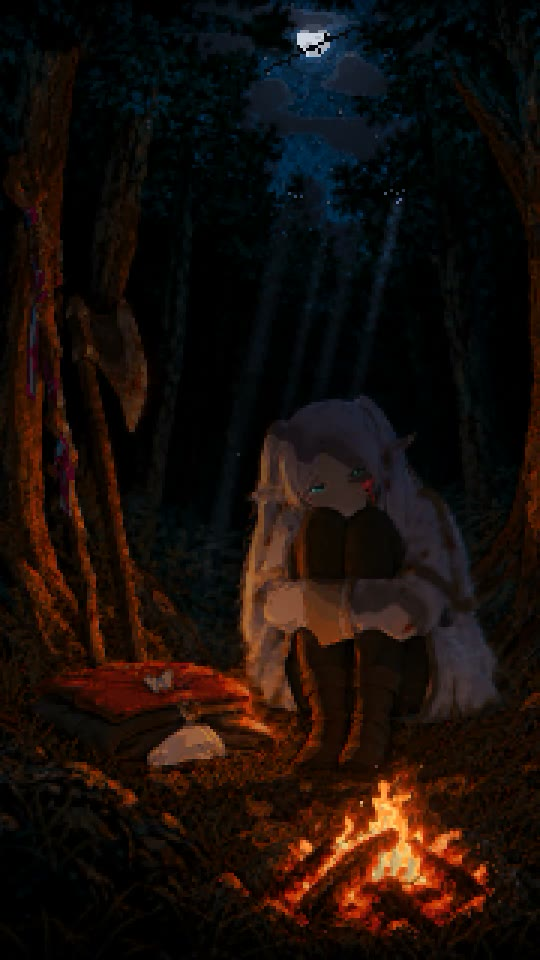
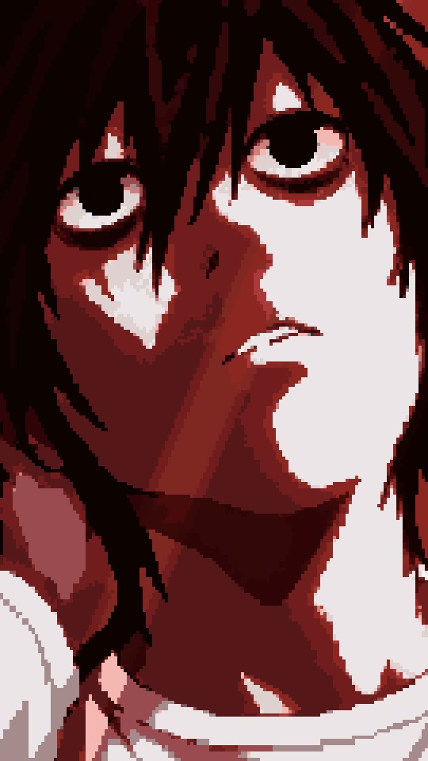
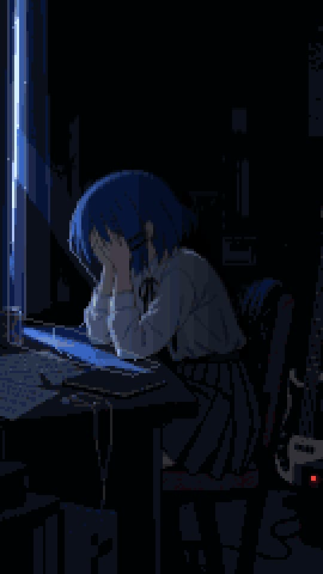

# Artlas

<table>
  <tr>
    <td></td>
    <td></td>
    <td></td>
    <td></td>
  </tr>
  <tr>
    <td></td>
    <td></td>
    <td></td>
    <td></td>
  </tr>
</table>

Dark pixel-anime mood reels: one character moment redrawn as a pixel scene, one light, slow motion, a song playing inside the room.

## Use

```bash
git clone https://github.com/rlaope/artlas.git
mkdir -p ~/.hermes/skills/creative
cp -r artlas/skills/atlas-pixel-mood-reel ~/.hermes/skills/creative/
```

Then ask Hermes Agent for a reel in plain words. Rules and pipeline: [`SKILL.md`](skills/atlas-pixel-mood-reel/SKILL.md). One piece end to end: [`docs/GUIDE.md`](docs/GUIDE.md).

## Credits

Made by [rlaope](https://github.com/rlaope) (khope) with the agents Frieren and Kami. Characters, scenes and songs belong to their rights holders; this is fan art. Text and code are MIT licensed.
