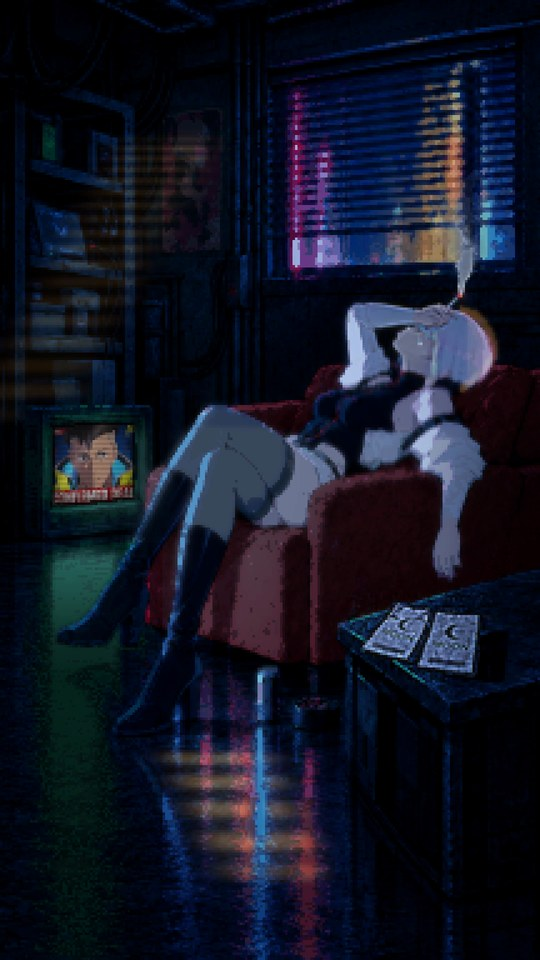
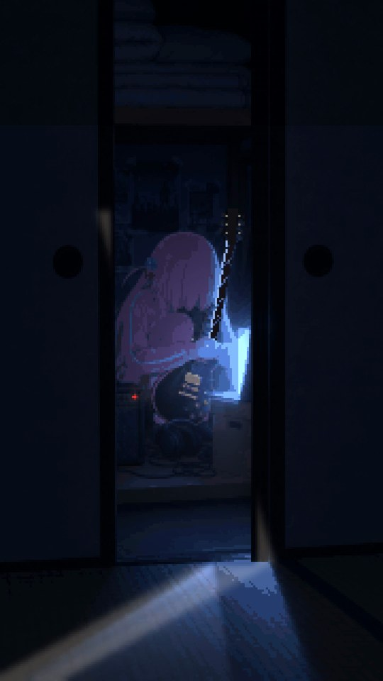
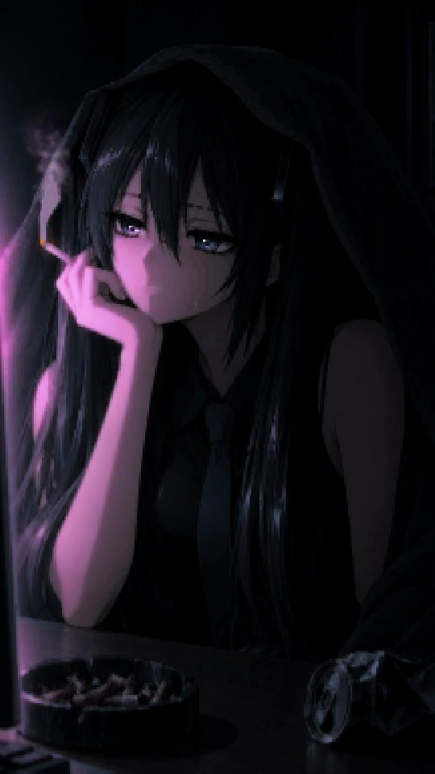
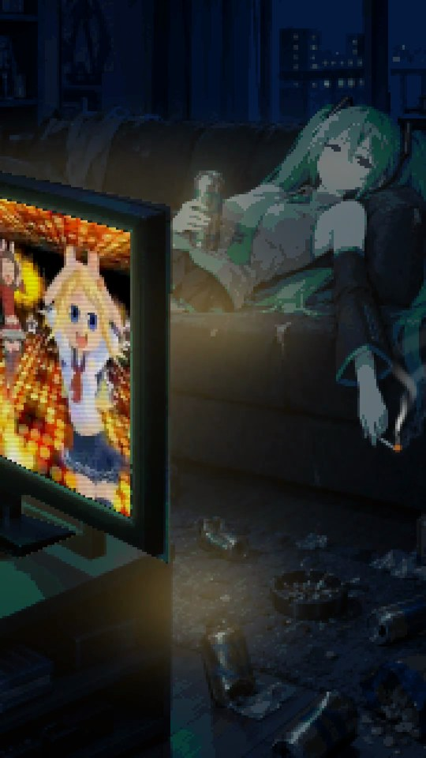
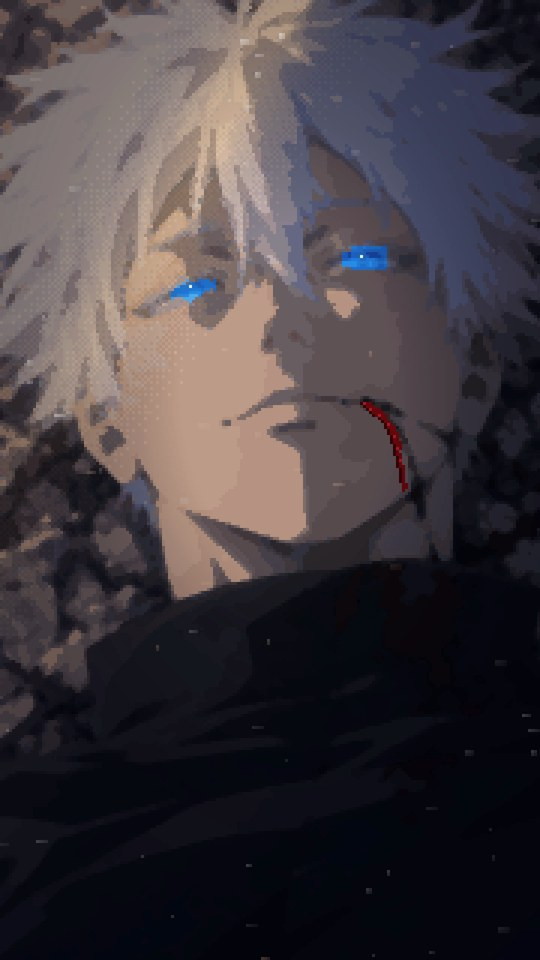

# Atlas

Dark pixel-anime mood reels: a famous character moment redrawn as a still pixel scene. One light falls across it, things move slowly, and a song plays inside the room.

This repository holds the gallery of finished pieces, the skill that produces them, and a step-by-step guide.

## The core

Every piece is judged by four things:

1. **High-quality dot art, and the dissonance it creates.** The grid is coarse enough to read as pixel art on a phone, and the drawing under it is TV-anime quality. The tension between the two is the look.
2. **Gloom.** A dark room at night, decadent and lonely. No sweet or pastel grading.
3. **Light staging.** One source, a visible light shape on the face, the hands and the smoke, changing slowly.
4. **Darkness staging.** Whatever the light does not reach sinks into darkness.

The full rule set, the defaults that change per piece (face, song, spatial sound, effects) and the pipeline are in [`skills/atlas-pixel-mood-reel/SKILL.md`](skills/atlas-pixel-mood-reel/SKILL.md). [`docs/GUIDE.md`](docs/GUIDE.md) walks through one piece end to end.

## Gallery

Still captures from the five delivered clips. The videos and songs are not stored here.

<table>
  <tr>
    <td align="center" width="33%"><br><b>Lucy, after David</b><br><sub>Cyberpunk: Edgerunners · 25 s<br>I Really Want to Stay at Your House</sub></td>
    <td align="center" width="33%"><br><b>Bocchi in the closet</b><br><sub>Bocchi the Rock! · 30 s<br>ギターと孤独と蒼い惑星</sub></td>
    <td align="center" width="33%"><br><b>Monitoring</b><br><sub>Hatsune Miku · 25 s<br>DECO*27 モニタリング</sub></td>
  </tr>
  <tr>
    <td align="center"><br><b>Miku on the sofa</b><br><sub>Hatsune Miku · 20 s<br>Caramelldansen</sub></td>
    <td align="center"><br><b>Gojo</b><br><sub>Jujutsu Kaisen · 15 s<br>青のすみか</sub></td>
    <td></td>
  </tr>
</table>

## Use the skill

```bash
git clone https://github.com/rlaope/atlas.git
mkdir -p ~/.hermes/skills/creative
cp -r atlas/skills/atlas-pixel-mood-reel ~/.hermes/skills/creative/
```

Then ask Hermes Agent for a reel in plain words, for example: "a dark pixel clip of Lucy in her armchair at 3 a.m., the TV playing the news, with I Really Want to Stay at Your House".

## Layout

```
skills/atlas-pixel-mood-reel/   the skill: core rules, defaults, pipeline
  references/                   detailed recipes (light, smoke, eyes, TV, audio)
docs/GUIDE.md                   one piece from request to delivery
docs/gallery/                   still captures of finished pieces
```

## Credits

Made by [rlaope](https://github.com/rlaope) (khope) with the agents Friren and Kami. Friren built most of the pieces; Kami finished *Monitoring*, ran the reviews and kept the ledger.

The characters, scenes and songs belong to their creators and rights holders. This is fan art. The text and code in this repository are MIT licensed.
